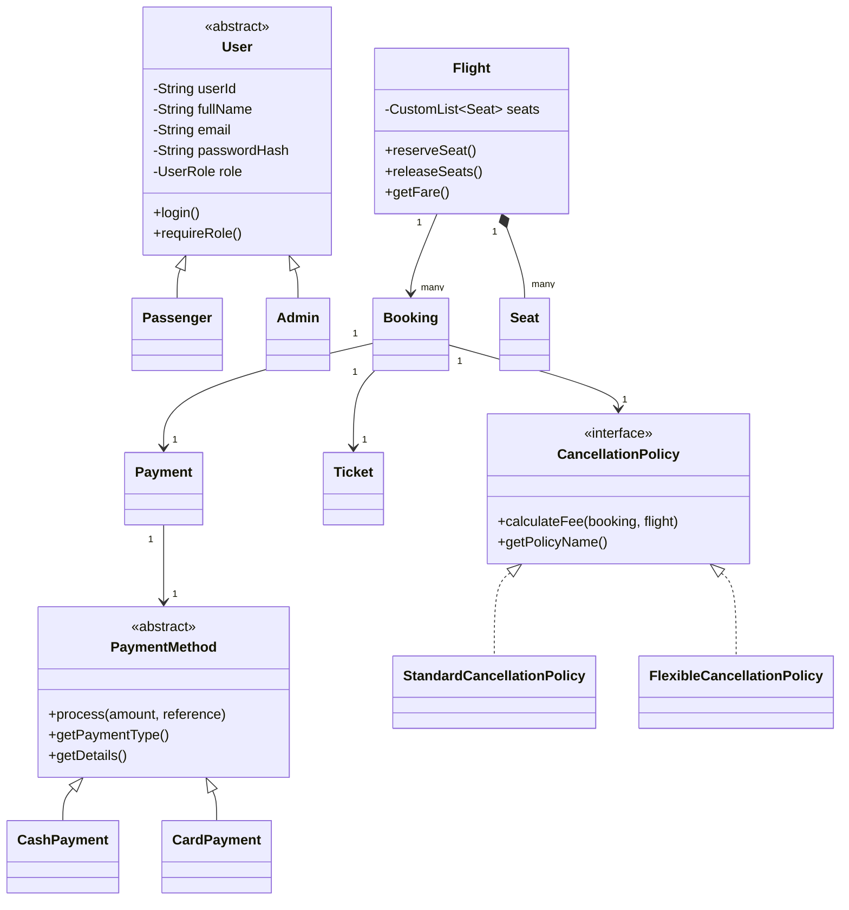
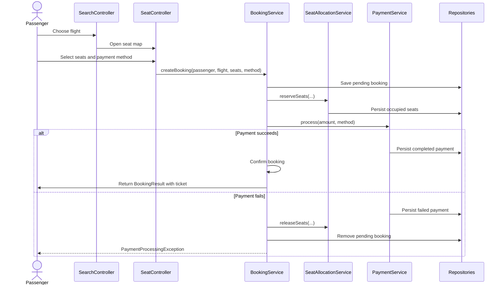
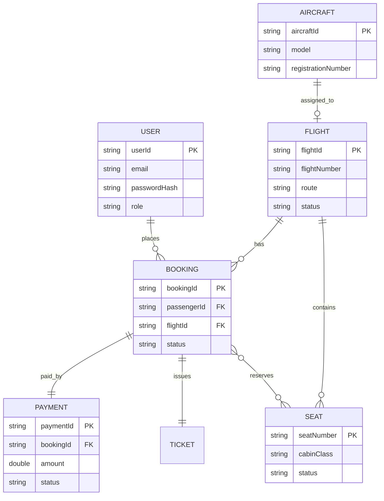

# AeroReserve — Flight Reservation & Airline Management System

A desktop **flight reservation and airline operations platform** built with Java 24, JavaFX 24 and Maven. AeroReserve demonstrates object-oriented design, layered architecture, polymorphic payment and cancellation strategies, generic collections, serialized persistence, role-based access control and a premium glassmorphism UI.

Repository: https://github.com/the-5ultan/Flight-Reservation-and-Airline-Management-System.git

---

## Table of contents

- [Overview](#overview)
- [Features](#features)
- [Architecture](#architecture)
- [Object-oriented design](#object-oriented-design)
- [Diagrams](#diagrams)
- [Project structure](#project-structure)
- [Domain model and business rules](#domain-model-and-business-rules)
- [Persistence](#persistence)
- [Technology stack](#technology-stack)
- [Setup and run](#setup-and-run)
- [Default accounts](#default-accounts)
- [Testing](#testing)
- [Git history](#git-history)
- [Known limitations](#known-limitations)
- [Future work](#future-work)
- [Contributors](#contributors)

---

## Overview

AeroReserve is a single-user JavaFX application that covers the full lifecycle of an airline reservation:

1. An administrator configures aircraft and publishes flights.
2. A passenger searches flights and selects seats from a live cabin map.
3. The system calculates the class-based fare, applies taxes and fees, processes a simulated payment and issues an electronic ticket.
4. Passengers and administrators can cancel bookings; cancellation fees depend on the selected policy and time before departure.
5. Reports aggregate live flight, seat, booking and revenue data from local serialized repositories.

The application uses **no external database**; all state is persisted to `data/*.ser` files with atomic writes, backups and corruption quarantine.

---

## Features

### Administrator

- Create, update, delete and cancel flights.
- Add, update and delete aircraft with configurable first, business and economy cabin layouts.
- View and manage all passengers and bookings.
- Cancel any booking with policy-based fees and refunds.
- View live dashboard statistics: flights, passengers, bookings, seats, revenue, popular routes.
- Search and filter bookings by status, reference, flight, passenger or seat.
- Update profile and password.

### Passenger

- Personal dashboard with booking, upcoming trip, seat and spending figures.
- Search flights by route, date, passengers, price, available seats, status and sort option.
- Interactive seat map with cabin-class colouring and live fare calculation.
- Create bookings with cash or card payment.
- View, export and print electronic tickets.
- Cancel bookings and see the applicable fee and refund.
- Update profile and password.

### System

- Role-based authorization enforced in both UI and service layer.
- Sequential, globally unique identifiers for users, flights, bookings, payments and tickets.
- PBKDF2 password hashing with random salt.
- Thread-safe seat reservation and release.
- Booking transaction rollback when seat reservation or payment fails.
- Polymorphic cancellation policies: standard and flexible.
- Premium glassmorphism CSS theme with responsive tables, cards, pills and charts.

---

## Architecture

AeroReserve follows a layered MVC-style architecture:

| Layer | Package | Responsibility |
|---|---|---|
| Application | `com.aeroreserve.app` | JavaFX entry point, service composition and first-run seeding |
| UI | `com.aeroreserve.ui` | Scene navigation, dialogs, shared formatting and printing |
| Controllers | `com.aeroreserve.controller` | FXML event handlers and screen state |
| Services | `com.aeroreserve.service` | Business rules, transactions, authorization, reporting |
| Repositories | `com.aeroreserve.repository` | Generic and specialized serialized persistence |
| Models | `com.aeroreserve.model` | Domain entities, value objects, policies and strategies |
| Enums | `com.aeroreserve.enums` | Cabin classes, statuses, roles, sort and payment types |
| Exceptions | `com.aeroreserve.exception` | Checked business exceptions |
| Utilities | `com.aeroreserve.util` | Password, validation, file and identifier helpers |
| Generic | `com.aeroreserve.generic` | Hand-written generic `CustomList<T>` |

`ServiceContainer` is the composition root. It creates repositories, wires services, seeds development data on first run and exposes a single application-wide instance.

---

## Object-oriented design

| Concept | Implementation |
|---|---|
| Abstraction | `User` is abstract; `PaymentMethod` and `CancellationPolicy` define polymorphic behaviour |
| Inheritance | `Passenger` and `Admin` extend `User`; `CashPayment` and `CardPayment` extend `PaymentMethod` |
| Polymorphism | Fare multipliers live in `SeatClass`; payment processing and cancellation fees are strategy methods |
| Encapsulation | Domain fields are private and exposed through validated getters/setters; `Ticket` defensively copies its seat list |
| Interfaces | `CancellationPolicy`, `Serializable` entities |
| Generic collections | `CustomList<T>` supports add, remove, filter, iteration, defensive snapshots and bounds checks |
| Singleton | `ServiceContainer.initialize(...)` / `ServiceContainer.get()` |
| Repository pattern | `SerializedRepository<T>` plus specialized repositories |
| Factory-style construction | Services create domain objects with generated identifiers and validated state |
| DTO | `FlightSearchCriteria`, `BookingResult`, `DashboardStatistics` |
| MVC | FXML views + JavaFX controllers + service/model layers |
| Dependency inversion | Controllers depend on service APIs, not persistence details |

---

## Diagrams

### Use case diagram

```mermaid
usecaseDiagram
    actor Passenger
    actor Admin

    rectangle "AeroReserve" {
        usecase "Register / Login" as UC_LOGIN
        usecase "Search flights" as UC_SEARCH
        usecase "Select seats" as UC_SEAT
        usecase "Book and pay" as UC_BOOK
        usecase "View / export ticket" as UC_TICKET
        usecase "Cancel booking" as UC_CANCEL
        usecase "Update profile" as UC_PROFILE

        usecase "Manage aircraft" as UC_AIRCRAFT
        usecase "Manage flights" as UC_FLIGHT
        usecase "Manage passengers" as UC_PASSENGERS
        usecase "View all bookings" as UC_BOOKINGS
        usecase "View reports" as UC_REPORTS
    }

    Passenger --> UC_LOGIN
    Passenger --> UC_SEARCH
    Passenger --> UC_SEAT
    Passenger --> UC_BOOK
    Passenger --> UC_TICKET
    Passenger --> UC_CANCEL
    Passenger --> UC_PROFILE

    Admin --> UC_LOGIN
    Admin --> UC_AIRCRAFT
    Admin --> UC_FLIGHT
    Admin --> UC_PASSENGERS
    Admin --> UC_BOOKINGS
    Admin --> UC_REPORTS
    Admin --> UC_CANCEL
    Admin --> UC_PROFILE
```

### Class diagram (core OOP structure)



### Booking sequence diagram



### Persistence diagram



---

## Project structure

```text
src/
  main/
    java/com/aeroreserve/
      app/            AeroReserveApplication, ServiceContainer
      controller/     FXML controllers for login, shell and all screens
      enums/          Domain enumerations
      exception/      Checked business exceptions
      generic/        CustomList<T>
      model/          Domain entities, DTOs and strategies
      repository/     Generic and specialized serialized repositories
      service/        Business services
      ui/             SceneManager, DialogManager, UiUtil
      util/           PasswordUtil, ValidationUtil, FileStorageUtil, IdGenerator
    resources/
      fxml/           13 FXML screens
      css/theme.css   Glassmorphism theme
  test/java/com/aeroreserve/
      CoreAndModelTest.java
      ServiceFlowTest.java
      TestFixtures.java
data/                  Generated serialization files (ignored by Git)
pom.xml
```

---

## Domain model and business rules

### Seats and fares

- Each aircraft has configurable rows and column letters for first, business and economy cabins.
- Every flight receives an independent copy of the aircraft seat template.
- Fare multipliers: economy `1.0x`, business `1.75x`, first `2.6x`.
- Taxes and fees: `7.5%` of the base fare plus a `$12.00` service fee.
- Seat reservation is `synchronized`; occupied seats cannot be double-booked.
- Selected seats must belong to the same cabin class.

### Cancellation policies

| Policy | Applies to | Fee |
|---|---|---|
| Flexible | First class | `0%` if more than 24h before departure, otherwise `10%` |
| Standard | Business and economy | `>168h: 10%`, `>48h: 25%`, `>24h: 40%`, otherwise `60%` |

Flight cancellation by an administrator is a separate operational action: it cancels affected bookings with **zero fee and a full refund**.

### Payments

- `CashPayment` validates a positive amount and records a counter location.
- `CardPayment` masks the card number and rejects expired cards.
- `PaymentService` persists both successful and failed attempts.
- Refunds may be partial or full and update payment status accordingly.

### Validation and exceptions

- Email, airport codes, passwords, phone numbers, schedules and fares are validated centrally.
- Business failures are represented by checked exceptions such as `AuthenticationException`, `DuplicateUserException`, `FlightNotFoundException`, `SeatAlreadyBookedException`, `InsufficientSeatsException`, `PaymentProcessingException` and `UnauthorizedActionException`.
- `BookingService.createBooking(...)` rolls back seats and the pending booking if any later step fails.

---

## Persistence

`SerializedRepository<T>` writes the full entity map to disk on every mutation.

| File | Contents |
|---|---|
| `data/users.ser` | Passengers and administrators |
| `data/aircraft.ser` | Aircraft configurations |
| `data/flights.ser` | Flights with independent seat inventories |
| `data/bookings.ser` | Reservations |
| `data/payments.ser` | Payment and refund records |

`FileStorageUtil`:

- creates the data directory when needed,
- writes to `*.tmp` before an atomic move,
- keeps the previous version as `*.bak`,
- renames unreadable files to `*.corrupt` and starts with an empty repository.

All runtime data files are ignored by Git.

---

## Technology stack

| Component | Version |
|---|---|
| Java / JDK | 24 |
| JavaFX | 24.0.2 |
| Maven | 3.10.0 or newer |
| Maven Compiler Plugin | 3.14.1 |
| Maven Surefire Plugin | 3.5.6 |
| OpenJFX Maven Plugin | 0.0.8 |
| JUnit Jupiter | 6.0.3 |

---

## Setup and run

### Prerequisites

- JDK 24 installed.
- Maven 3.10+ installed or available through your IDE.
- Git.

### Clone

```bash
git clone https://github.com/the-5ultan/Flight-Reservation-and-Airline-Management-System.git
cd Flight-Reservation-and-Airline-Management-System
```

### Build and test

```bash
mvn clean test
mvn -DskipTests package
```

### Run

```bash
mvn javafx:run
```

On the development Windows machine where Java and Maven are not on `PATH`, use the absolute tool paths:

```powershell
$env:JAVA_HOME = "D:\JDK's"
& "C:\Users\Sultan\.m2\wrapper\dists\apache-maven-3.10.0-bin\39q0qgmngdu329psje7bjgne79\apache-maven-3.10.0\bin\mvn.cmd" javafx:run
```

The first run seeds demo aircraft, flights, passengers and default accounts into `data/`. Delete the `data/` directory to regenerate the seed data.

---

## Default accounts

These accounts are for **development and demonstration only**. Change or remove them before any real deployment.

| Role | Email | Password |
|---|---|---|
| Administrator | `admin@aeroreserve.com` | `AdminPass123` |
| Operations administrator | `ops@aeroreserve.com` | `OpsPass123` |
| Passenger | `passenger@aeroreserve.com` | `Passenger123` |

Passwords are stored as PBKDF2 hashes with per-user random salts; plaintext passwords are not persisted.

---

## Testing

The JUnit 6 suite covers:

- password hashing, validation rules and normalisation,
- `CustomList<T>` mutation, filtering, snapshots and bounds checks,
- serialized repository round-trips and removal,
- ticket defensive copying and text/HTML rendering,
- cancellation policy fee tiers,
- authentication, registration, login and role enforcement,
- flight schedule validation and search filtering,
- seat reservation, conflict detection and release,
- booking creation, payment confirmation, ticket generation and rollback,
- cancellation refunds and policy fees,
- payment status transitions and failed-card handling,
- report aggregation.

Run:

```bash
mvn test
```

Current result: **15 tests, 0 failures, 0 errors**.

All 13 FXML screens were additionally load-tested with a JavaFX toolkit harness.

---

## Git history

Development was delivered in reviewed increments:

| Commit | Description |
|---|---|
| `9a2fde4` | Initial repository state |
| `2a17569` | JavaFX Maven project and glassmorphism login shell |
| `91629c7` | Core domain models, enums, exceptions and `CustomList<T>` |
| `8379cba` | Serialized persistence and centralized repositories |
| `f3634cc` | Authentication, flight, seat, booking, payment and report services |
| `66eacaf` | Role-aware JavaFX UI with booking and admin flows |
| `227dabf` | JUnit coverage for services and model edge cases |

---

## Known limitations

- Local serialization is suitable for a desktop demo, not concurrent multi-user production use.
- Payments and card validation are simulated; no gateway or bank integration exists.
- Passwords are hashed, but there is no account lockout, MFA, password reset or email verification.
- Electronic tickets are plain text and can be printed through the operating-system print dialog; no QR/barcode is generated.
- Cancellation fees use wall-clock time at the moment of cancellation.
- A failed payment record intentionally remains after booking rollback for audit visibility.

---

## Future work

- Replace serialized files with an embedded SQL database such as SQLite or H2.
- Add QR-coded boarding passes and PDF export.
- Add seat maps as reusable FXML components with animated selection.
- Add email/SMS notifications for booking confirmation and cancellation.
- Add account lockout, MFA and secure password recovery.
- Add internationalization and theme switching.
- Package a native installer with `jlink`/`jpackage`.

---

## Contributors

- **the-5ultan** — project owner and implementation.
